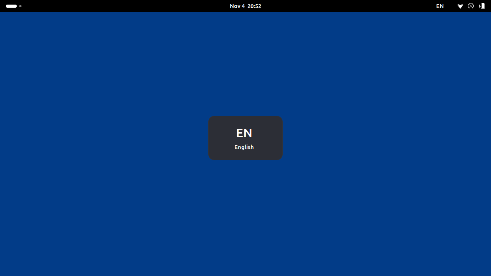
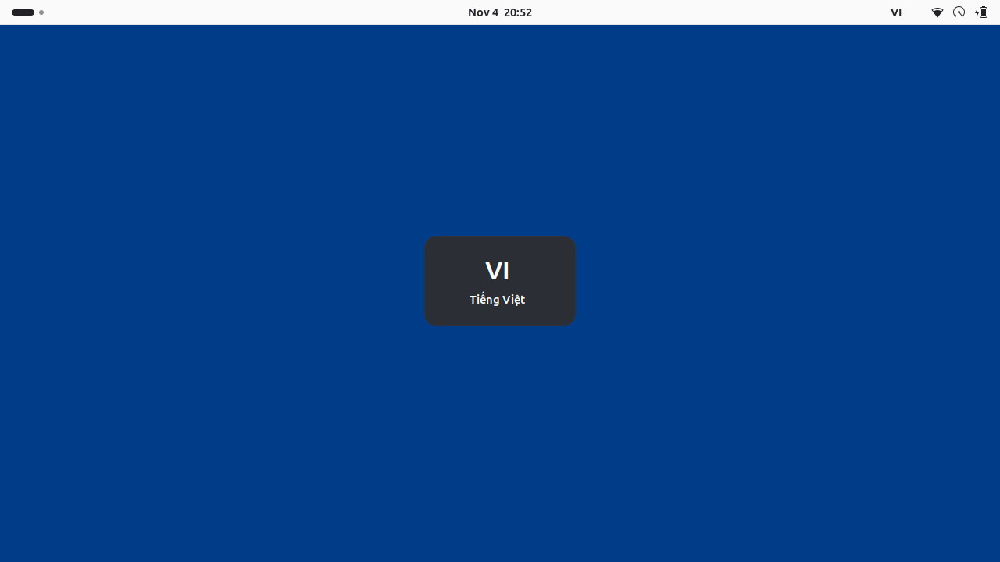

# GNOME language indicator

An optional Fcitx module publishes effective input-method state, and a GNOME
Shell 50 extension renders a panel label and a centered, non-interactive popup.
The module is independent of the on-demand Bamboo engine, so English works
before Bamboo is first selected. It does not process keys or send preedit,
surrounding text, or input-context identifiers over D-Bus.

| English | Vietnamese (light theme) |
| --- | --- |
|  |  |

See the [installation guide](../../INSTALL.md#optional-envi-top-bar-and-centered-popup-on-gnome-50)
for dependencies, build commands, activation, and removal.

## D-Bus interface

The module uses Fcitx's existing `org.fcitx.Fcitx5` session bus connection:

- Object path: `/bamboo/indicator`
- Interface: `org.fcitx.Fcitx.Bamboo.Indicator1`
- Method: `GetState() → (ssss)`
- Signal: `StateChanged(ssss)`

Both contain input-method ID, language code, compact label, and display name,
in that order. An empty input-method ID means unavailable. The bridge resolves
the most recent input context when its deferred update runs and emits only
changed tuples. Related focus, group, and activation events share one deferred
source. It retains no input-context pointers. Selection and configuration use
the existing `/controller` interface, not a second implementation of switching.

The extension subscribes to the current unique bus owner before querying state.
A generation counter rejects callbacks from old connections; a revision counter
prevents an older query reply from replacing newer signals. Initial and reconnect
snapshots update silently. Disabling cancels all requests, removes watches and
subscriptions, clears the dismissal timeout, stops animations, and destroys the
panel and popup actors. No recurring timeout or helper process is used.

## Tests

With `ENABLE_GNOME_INTEGRATION=ON` and `BUILD_TESTING=ON`, CTest includes:

- A real bridge/D-Bus/Fcitx test with an isolated bus and test frontend: English,
  Vietnamese, composition commit on switching, per-app focus changes, context
  destruction, group changes, duplicate suppression, and a burst of 10,000
  switches. The test supplies a pass-through keyboard engine because distribution
  builds link the real keyboard engine directly into the `fcitx5` executable.
- GJS tests, when `gjs` is installed: stale query responses, reconnection,
  cancellation, foreign-language presentation, and 10,000 timer replacements.
- A GJS client test over a real private D-Bus connection: owner loss and
  reacquisition, signal/query races, cancellation, and a missing bridge.

Run the actual extension in an isolated GNOME Shell 50 with temporary settings,
a private runtime directory, and a private session bus:

```sh
cmake --build build-native --target gnome-extension
sh integrations/gnome/tests/run-shell-test.sh \
  "$PWD/build-native/integrations/gnome/bamboo-indicator@fcitx5-bamboo.shell-extension.zip"
```

This checks panel text, popup title and centering, silent initial synchronization,
duplicate events, dismissal, unavailable state, light/dark themes, and 100
enable/disable cycles with stable actor counts. Set `BAMBOO_SCREENSHOT_DIR` to an
existing directory to capture English and Vietnamese screenshots. The shell test
supplies deterministic states to the UI; CTest separately exercises the real
Fcitx/D-Bus bridge. The test also inhibits animations after startup and checks
immediate fade completion.

For native memory checks, configure a separate build with
`-fsanitize=address,undefined -fno-omit-frame-pointer` in `CMAKE_CXX_FLAGS` and
`-fsanitize=address,undefined` in both `CMAKE_EXE_LINKER_FLAGS` and
`CMAKE_MODULE_LINKER_FLAGS`. Run CTest with `ASAN_OPTIONS=detect_leaks=1` and
`UBSAN_OPTIONS=halt_on_error=1`. CI also checks GCC and Clang builds.

Before a release, verify GTK, Qt, and Electron applications, multi-monitor and
fractional-scale positioning, fullscreen, lock/unlock, light/dark themes, and
reduced animations in a real session. The extension declares only GNOME 50
support; expand the metadata only after testing additional Shell versions.
